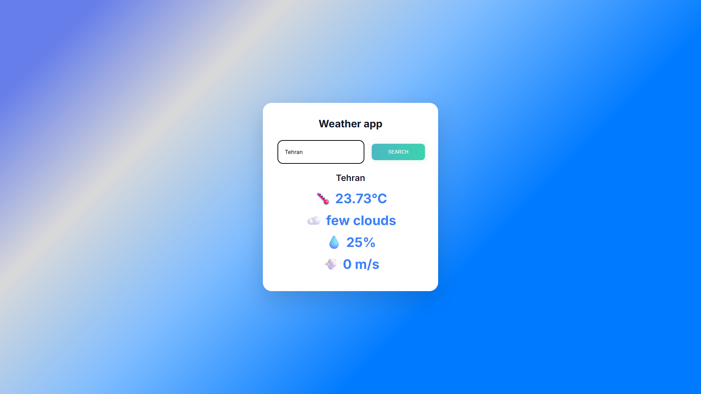
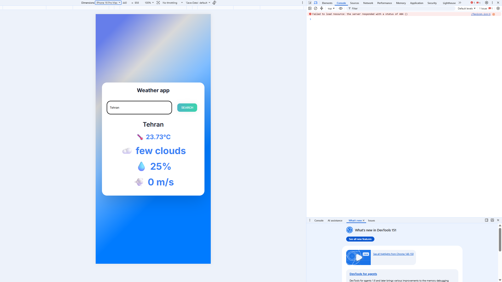

markdown
# 🌤️ Weather App

A modern weather application built with vanilla JavaScript. Search any city and get real-time weather data.



## ✨ Features

- 🔍 **City Search** — Search weather by city name
- ⌨️ **Enter Support** — Press Enter to search
- 🌡️ **Temperature** — Current temperature in Celsius
- ☁️ **Weather Condition** — Clear descriptions from API
- 💧 **Humidity** — Current humidity percentage
- 💨 **Wind Speed** — Wind speed in m/s
- 📱 **Responsive** — Works on mobile and desktop
- 🎨 **Modern UI** — Clean design with gradient background

## 🛠️ Tech Stack

- **HTML5** — Semantic markup
- **CSS3** — Flexbox, gradients, transitions
- **JavaScript (ES6+)** — Async/Await, Modules, Destructuring
- **OpenWeather API** — Real-time weather data

## 🔗 Live Demo

👉 [View Live Demo](https://weather-app-lime-rho-60.vercel.app/)

## 📸 Screenshots

### Desktop


### Mobile


## 🏃 How to Run

1. **Clone the repository**
```bash
git clone https://github.com/DomCraft-Dev/weather-app.git
Get a free API Key

Sign up at OpenWeather

Copy your API key

Create config.js in the project root:

js
export const API_KEY = "your-api-key-here";
Run with Live Server

Open index.html with Live Server (VS Code extension)

Or use:

bash
python -m http.server 8000
📂 Project Structure
text
weather-app/
├── index.html          # Main HTML file
├── style.css           # Styles
├── script.js           # JavaScript logic
├── config.js           # API key (not in repo)
└── README.md           # This file
💡 How It Works
State
js
const BASE_URL = "https://api.openweathermap.org/data/2.5/weather";
Fetch Weather
js
async function getWeather(city) {
  const url = `${BASE_URL}?q=${city}&appid=${API_KEY}&units=metric`;
  const res = await fetch(url);
  const data = await res.json();
  
  const { name, main, weather, wind } = data;
  // render UI
}
API Response (simplified)
js
{
  name: "Tehran",
  main: { temp: 25, humidity: 40 },
  weather: [{ description: "clear sky" }],
  wind: { speed: 5 }
}
🎯 What I Learned
Building this project taught me:

✅ Async/Await — Handling asynchronous operations

✅ Fetch API — Making HTTP requests

✅ Error handling — API errors, empty input

✅ Destructuring — Extracting data from API responses

✅ Template Literals — Building dynamic HTML

✅ ES6 Modules — import / export

✅ Environment Variables — Hiding API keys with config.js

🗺️ Roadmap
☑ v1 — Basic search + display
☑ v1.5 — Enter key support
☑ v2 — Modern UI redesign
□ v3 — City autocomplete suggestions
□ v4 — 5-day forecast
□ v5 — Geolocation (current city)
□ v6 — Dark mode
□ v7 — React rewrite
🤝 Contributing
Contributions, issues, and feature requests are welcome!

📝 License
This project is MIT licensed.

👤 Author
Mohammad

GitHub: @DomCraft-Dev

Telegram: @DomCraft

⭐ If you like this project, give it a star!